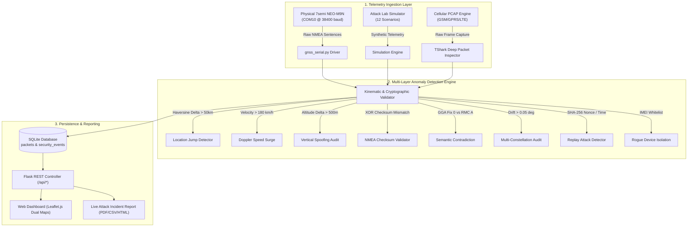

# 🛡️ TrackGuard: Real-Time Cyber-Physical GNSS & Cellular Telemetry Defense Platform

TrackGuard is an enterprise cyber-physical security monitoring and anomaly-defense platform engineered to protect positioning, navigation, and timing (PNT) infrastructure against GNSS spoofing, RF jamming, serial packet injection, and cellular telematics exploitation.

It integrates live physical u-blox multi-constellation receivers, validates kinematic, temporal, and cryptographic invariants in real time, plots dynamic geodesic threat vectors on Leaflet maps, and provides an automated red-team attack simulation suite.

---

## 📌 System Architecture



---

## 🚨 Complete Taxonomy of 13 Registered Attack Vectors

TrackGuard monitors and defends against 13 distinct cyber-physical threat classes:

| ID | Attack Vector | Threat Class | Detection Invariant | Automated Mitigation |
| :---: | :--- | :--- | :--- | :--- |
| **01** | **Location Jump** | Geodesic Teleportation | Haversine distance $> 50.0\text{ km}$ in $\le 2.0\text{ s}$ | `QUARANTINE_POSITION` |
| **02** | **Speed Anomaly** | Kinematic Spoofing | Doppler velocity exceeds $180.0\text{ km/h}$ or acceleration $> 15\text{ m/s}^2$ | `RATE_LIMIT_VELOCITY` |
| **03** | **NMEA Data Injection** | Bus Protocol Tampering | 8-bit XOR checksum (`*hh`) mismatch or corrupted delimiters | `DROP_INVALID_FRAME` |
| **04** | **GNSS Signal Loss / Jamming** | RF Physical Layer | Satellites used drops to $0$ or $\text{HDOP} \ge 99.99$ while moving | `DEAD_RECKONING_FALLBACK` |
| **05** | **Timestamp Manipulation** | Temporal Inversion | Non-monotonic clock step ($\Delta t < 0$) or jump $> 300\text{ s}$ | `REJECT_OUT_OF_ORDER` |
| **06** | **GNSS Fix Contradiction** | Semantic Collision | Contradictory NMEA frames (GGA Fix 0 vs RMC Status A) | `FLAG_SEMANTIC_CONFLICT` |
| **07** | **Multi-Constellation Drift** | Selective Constellation Drift | Spatial discrepancy between GPS and GLONASS $> 0.05^\circ$ | `KALMAN_FILTER_SANITY_CHECK` |
| **08** | **Replay Attack** | Cryptographic Replay | SHA-256 fingerprint collision or re-used packet nonce | `BLOCK_REPLAY_PACKET` |
| **09** | **Altitude Spoofing** | Vertical Axis Manipulation | Vertical jump $> 500\text{ m}$ in 1s epoch or elevation $> 8,000\text{ m}$ MSL | `LOCK_ALTITUDE_BASELINE` |
| **10** | **IMEI Spoofing** | Rogue Cellular Clone | Cellular transmitter ID absent from authorized device whitelist | `ISOLATE_ROGUE_DEVICE` |
| **11** | **PCAP Malicious Payload** | In-Band Network Exploit | Deep Packet Inspection (DPI) matches shellcode or buffer overflow | `DROP_AND_ALERT_SOC` |
| **12** | **SDR RF Signal Distortion** | Synthetic IQ Waveform | Unnatural carrier power spikes and synthetic Doppler jitter | `REJECT_SYNTHETIC_RF` |
| **13** | **Coordinate Bounds Tampering** | Buffer / Range Overflow | Latitude $\notin [-90, +90]$ or Longitude $\notin [-180, +180]$ | `CLAMP_COORDINATES` |

---

## ⚡ Quick Start & Execution

### 1. Requirements & Prerequisites
- Python 3.10+ (tested with Python 3.11 Anaconda)
- Optional Hardware: 7semi NEO-M9N GNSS Receiver (u-blox M9) connected via USB

Install dependencies:
```bash
pip install -r requirements.txt
```

### 2. Start the TrackGuard Server
```bash
python dashboard/app.py
```
Open **[http://localhost:5001](http://localhost:5001)** in your browser.

### 3. Automated Attack Demonstration (Red-Team CLI)
Launch the interactive demonstration console:
```powershell
.\demonstrate_hardware_attacks.ps1
```
Or run the automated 7-step presentation cycle:
```powershell
.\demonstrate_hardware_attacks.ps1 -DemoAll
```

### 4. Running the Automated Test Suite
Execute the 20-test automated verification suite:
```bash
pytest tests/test_trackguard_suite.py -v
```

---

## 📊 Live Reports & Forensic Exports

From the running dashboard:
- **Interactive Live Incident Report**: Navigate to `/view-report` (supports print-to-PDF export).
- **Export CSV**: Navigate to `/download-report?format=csv`.
- **Export JSON**: Navigate to `/download-report?format=json`.

---

## 📁 Repository Directory Structure

```
TrackGuard/
├── dashboard/               # Flask Web Application & REST APIs
│   ├── app.py              # Main application controller
│   ├── attack_report.py    # Dynamic forensic incident report generator
│   ├── static/             # CSS, JavaScript, and static report assets
│   └── templates/          # HTML templates (dashboard.html)
├── hardware/                # Physical Serial Hardware Driver
│   └── gnss_serial.py      # Thread-safe u-blox M9 NMEA-0183 parser & auto-discovery
├── detection/               # Core Anomaly Detection Engines
│   └── detection.py        # Haversine, velocity, and semantic detection algorithms
├── mitigation/              # Automated Security Mitigation Dispatcher
│   └── mitigation.py       # Quarantine, rate limiting, and alert policies
├── simulator/               # Red-Team Simulation Suite
│   └── attack_lab.py       # 12 cyber-physical attack simulation scenarios
├── database/                # SQLite Schema & Data Access Layer
│   └── database.py         # Persistence for packets, events, and audit logs
├── core/                    # System utilities & TShark DPI wrappers
├── scripts/                 # CLI tools & report generation scripts
├── tests/                   # Automated pytest regression suite
└── demonstrate_hardware_attacks.ps1  # One-click demonstration runner
```

---

## 📄 License
This project is licensed under the MIT License.
